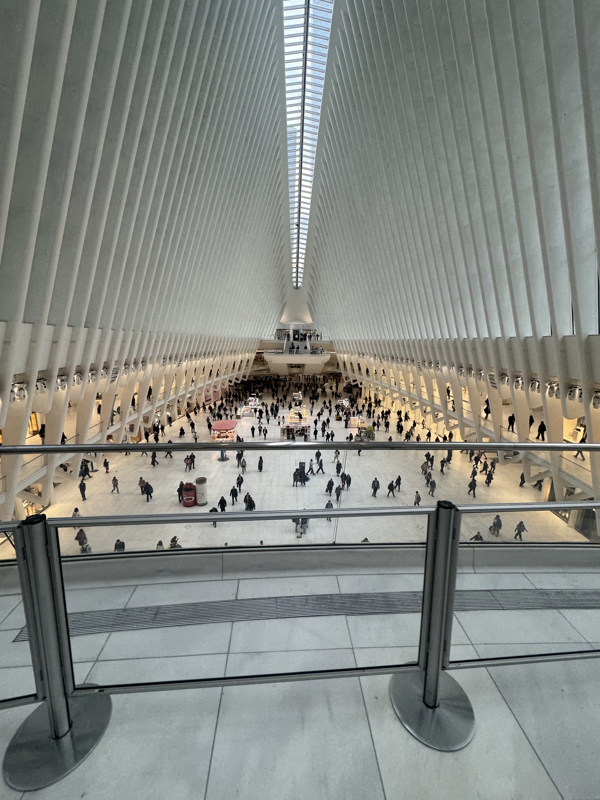
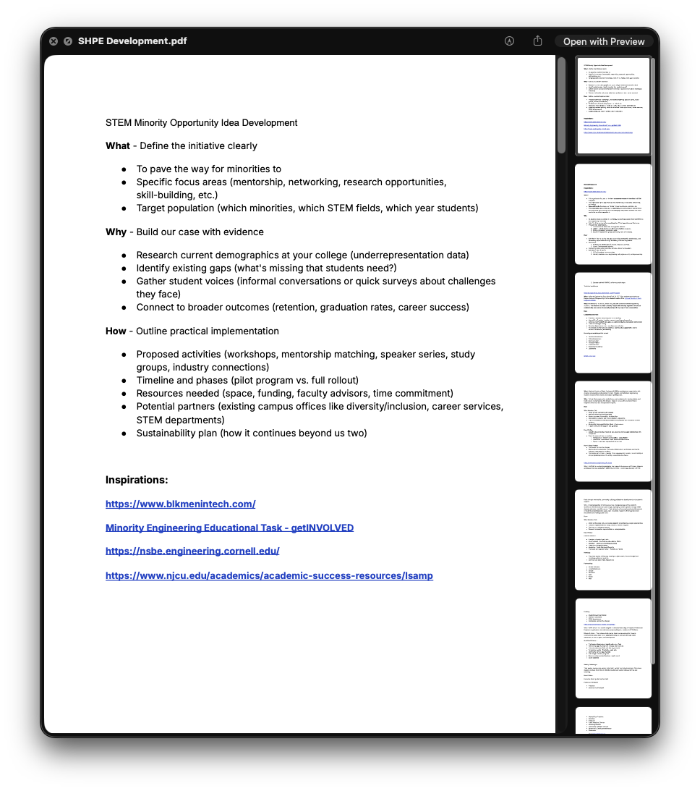
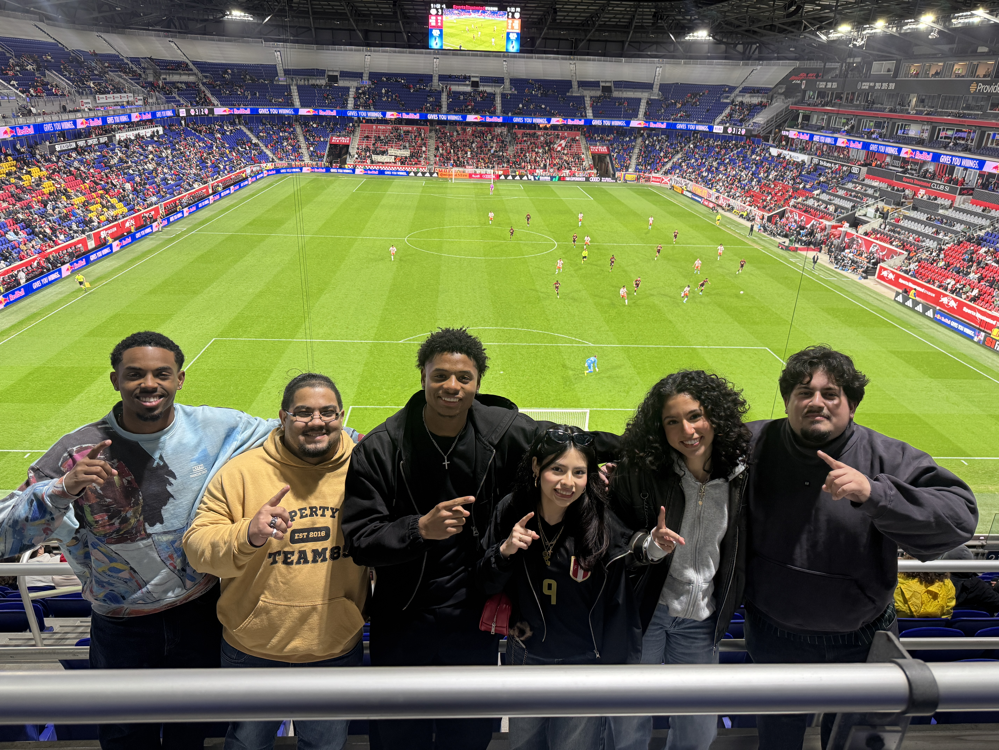
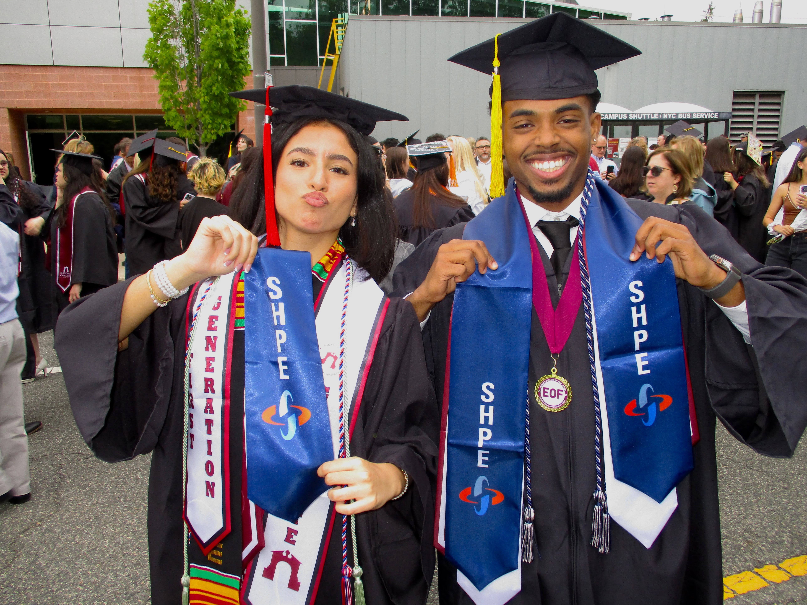

# The Pay-it-Forward Conversation(s)

Every year on my birthday at the end of October, I like to reflect on what I've learned in the past year and how my life has changed. Last year, life was rough to say the least, and I didn't get the chance to complete my ritual. I was the busiest I'd ever been in my life. I was conducting and presenting my research at conferences, was an RA, and was working a part-time job at QuickChek.&#x20;

\
This same month, my uncle gave me the opportunity to work alongside him and some pretty amazing people to build Centerpiece Insurance. When I started, I had an HP laptop, which had done it's job up to that point, but was starting to slow me down. On my second or third day, my uncle took me on a walk. He refused to tell me where, and I just had to trust him. 10 minutes later we end up at the Apple store…5 minutes later I walked out with a Macbook Pro.

\
\
I was confused, excited, and speechless all the way up until we got to the top of the stairs at the Oculus. The first thing that I asked him was why? He told me: "If I have the resources, there's no reason to keep them to myself. Why wouldn't I share it with you?" \
\
Fast forward to November. Life is still life-ing, and I'm searching for what my next purpose is going to be. My good friend Kevin Vallejo invited me to his Church one day, and it was there that I met Chris Shaw, and within 5 minutes of knowing this guy, he told me about people, opportunities, and experiences I knew nothing about. I asked him the same question I asked my Uncle and sure enough, he gave me the same answer.\
\
It was this day I realized I could do the same for others, provide opportunities where there were none. I became obsessed with figuring out a way to do it, everything else came second.

## The SHPE Saga Begins

Very quickly after, Kevin and I started doing research and having conversations with others on how we could bring opportunities to minorities in STEM. It wasn't long until Natalie Quiñones introduced me to NJIT SHPE, an organization her sorority sister was apart of during their undergrad.&#x20;

**SHPE** (Society of Hispanic Professional Engineers) is the **worlds largest network of Hispanics in STEM**.

SHPE was like the most important piece of the lego puzzle you had spent days trying to find and then your friend walks over and shows you exactly what you've been looking for.\
\

I reached out to their previous President, Pablo Leyva, EVP Franco Montes, and IVP Jason Tencio. Kevin and I met with Franco and Jason, and they gave us all the sauce we could ask for. Pablo and I had been struggling to get something on the calendar. Soon after, I met with Myriam Lopes, Director of Chapters and Regions at the time, and one of the sweetest people I have ever met and a guiding light throughout the entire process.\
\
Finally, Pablo and I met. From the moment the meeting started I knew this guy was a prodigy. We chopped it up and shared our visions with one another, all while he was getting changed to go an event in NYC. Pablo invited me to this event, I invited Kevin, and three hours later we were in the same room with all of NJIT SHPE, multiple professionals from New York, and the community that would go on to change our lives. \
\
From then on Kevin and I knew that what we we're trying to bring to life already existed, and **the only thing in between us and our vision was execution.**\
, Kevin (middle), handsome guy (me, right), at the SHPE NYC Event")

## The Great Lock-In

Kevin and I recruited the Avengers...:\
\- Julio Sarmiento (Chapter Advisor)\
\- Agnese-Karen Gamarra (Current VP)\
\- Nathan Camacho (Current Treasurer)\
\- Brianna Rached (Previous Marketing)\
… and we got to work.\
\
To make it a long story short, together we:

* Gained more than 50 members in our first semester.
* Became officially chartered and recognized by SHPE National.
* Hosted a Red Bulls Fundraising Game with 30+ people.
* Hosted John Canela (Google) as a speaker.
* Were recognized as Best New Organization in less than 3 months by the College.
* Recruited 2 amazing E-Board Members in Isiah Martinez and Saniyah Orr.
* Secured full funding for 8 members to attend their first National Convention!
* Hosted SHPE NJ Regional meeting with chapters all over NJ.

")

I like to think of myself as a humble person, but when it comes to SHPE, the growing community at Ramapo, and the endless opportunities that will snowball through generations, I could not be prouder. All of this started from two very simple and honest conversations. All Kevin and I did was take action.

## Next Stop: Indianapolis.

Our chapter is now convention-bound. The National Convention is considered the most opportunistic and fruitful time of the year by every SHPE member (that I've met). From the day we started SHPE, our #1 goal behind everything we've done, was to get our members to this convention. We'll be there in about 3 weeks.

\
See ya'll in Indy! ✌🏾
